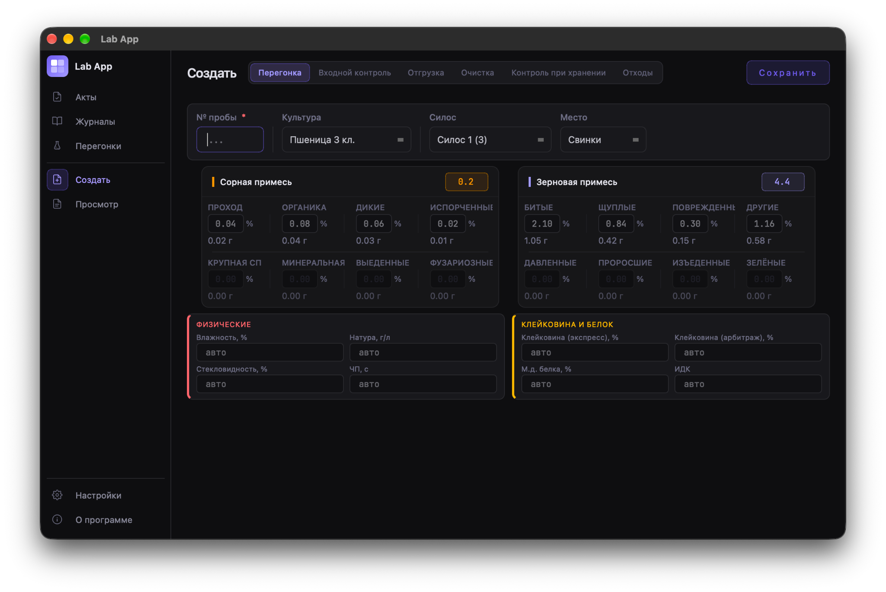
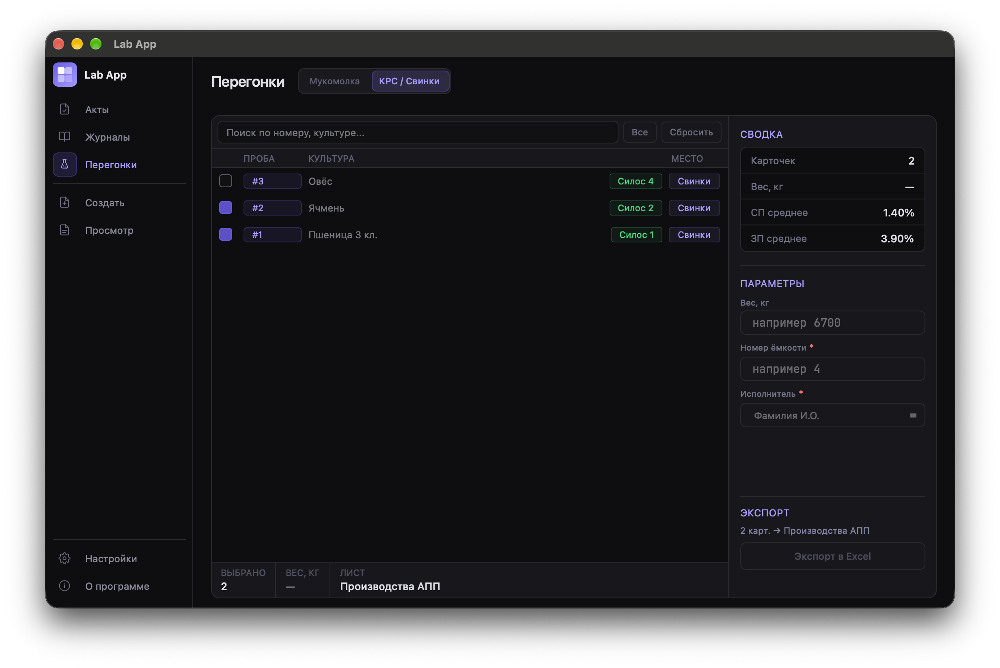
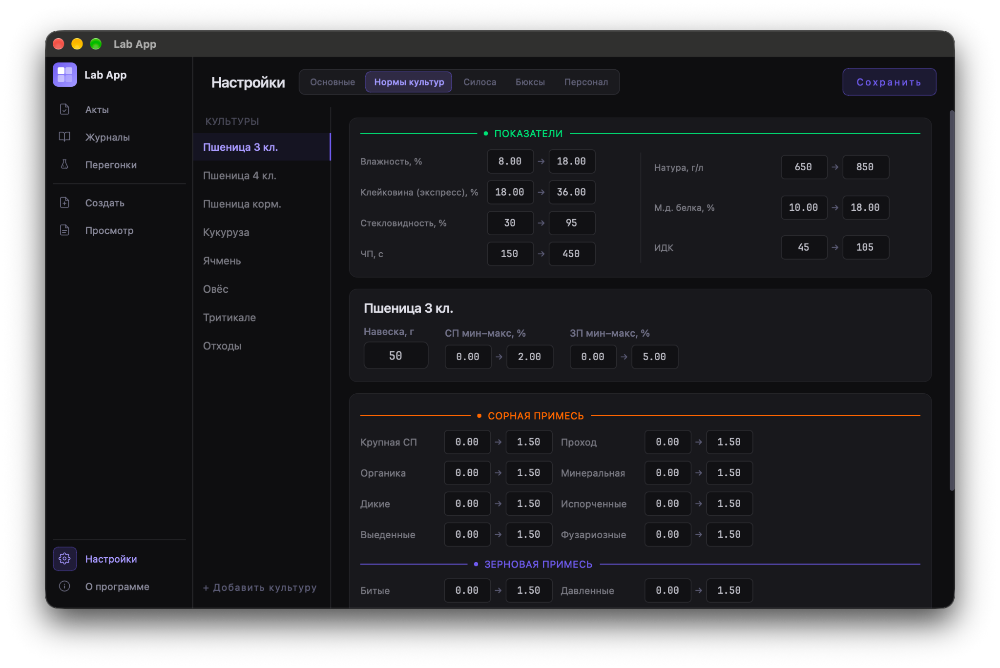
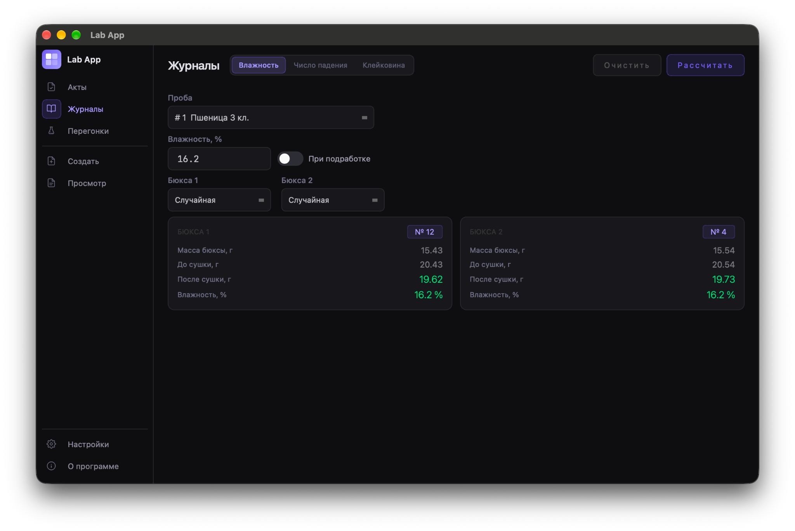

# Lab App

**Lab App** — настольное приложение для автоматизации лабораторного учёта и контроля качества зерна. Программа объединяет работу с карточками проб, лабораторные расчёты, журналы измерений, настройки нормативов и экспорт документов в одном графическом интерфейсе.

> Это демонстрационная версия для портфолио. Начальные данные предназначены только для ознакомления и не являются производственными нормативами.

## Возможности

- **Карточки проб:** создание и ведение записей с параметрами лабораторного контроля.
- **Лабораторные расчёты:** вычисление и обработка показателей качества.
- **Журналы измерений:** работа с результатами лабораторных измерений, включая влажность, клейковину и число падения.
- **Перегонки и учёт:** просмотр записей и подготовка данных для дальнейшей обработки.
- **Экспорт:** формирование документов Word и таблиц Excel.
- **Настройки:** управление параметрами культур, нормативами, силосами и сведениями о персонале.
- **Локальное хранение:** данные приложения хранятся в базе SQLite на компьютере пользователя.

## Скриншоты

### Создание карточки пробы



### Перегонки и экспорт в Excel



### Настройка нормативов качества



### Журналы лабораторных измерений



## Технологии

- **Python** — основной язык приложения.
- **PyQt6** — графический интерфейс.
- **SQLite** — локальная база данных.
- **openpyxl** — работа с Excel.
- **python-docx** — формирование документов Word.

## Требования

- Python 3.11 или новее;
- `pip`;
- операционная система с поддержкой PyQt6.

Проект запускался автором в отдельном виртуальном окружении на macOS. Работа на других ОС и версиях Python может потребовать дополнительной проверки.

## Установка и запуск

1. Клонируйте репозиторий и перейдите в каталог проекта:

   ```bash
   git clone https://github.com/hykami/lab_app.git
   cd lab_app
   ```

2. Создайте и активируйте виртуальное окружение.

   **macOS / Linux**

   ```bash
   python3 -m venv .venv
   source .venv/bin/activate
   ```

   **Windows PowerShell**

   ```powershell
   py -m venv .venv
   .venv\Scripts\Activate.ps1
   ```

3. Установите зависимости:

   ```bash
   python -m pip install --upgrade pip
   pip install -r requirements.txt
   ```

4. Запустите приложение:

   ```bash
   python main.py
   ```

При первом запуске приложение создаёт локальную базу `data/lab_app.db` и заполняет её демонстрационными начальными данными.

## Структура проекта

```text
lab_app/
├── assets/       # шаблоны документов и шрифты
├── data/         # инициализация и работа с SQLite
├── logic/        # бизнес-логика, расчёты и экспорт
├── screenshots/  # скриншоты интерфейса
├── ui/           # окна, страницы и компоненты интерфейса
├── utils/        # вспомогательные функции
├── config.py     # настройки приложения
├── main.py       # точка входа
└── requirements.txt
```

## Данные и конфиденциальность

База данных создаётся локально на компьютере пользователя и не входит в репозиторий. Для демонстрации используются стартовые данные. Не используйте их как реальные лабораторные нормативы и не добавляйте в публичный репозиторий рабочие базы данных, персональные сведения или конфигурационные файлы с секретами.
